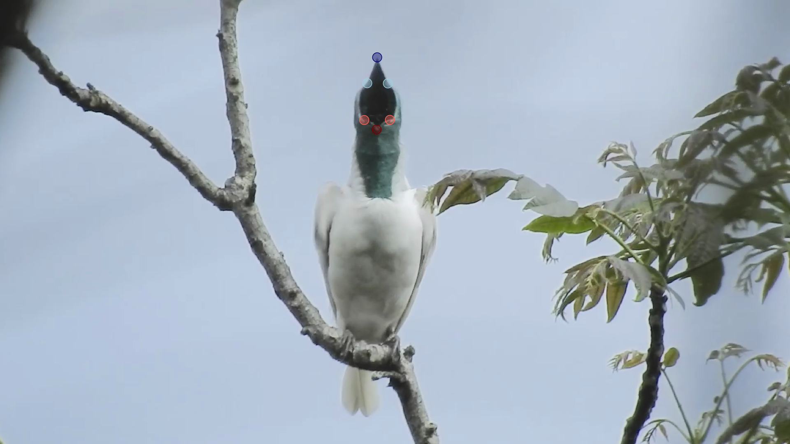

```{r, include=FALSE}
knitr::opts_chunk$set(
  collapse = TRUE,
  comment = "#>",
  fig.align = "center"
)
```

```{r setup}
library(araponga)
```

## Overview

`araponga` estimates possible three-dimensional (3D) orientations of directed objects from landmarks labeled in two-dimensional (2D) images or video frames.

A 2D projection generally does not uniquely determine a 3D orientation: many combinations of object orientation and camera position can produce the same image. Rather than selecting a single orientation without sufficient information, `araponga` identifies the configurations compatible with the observed projection and the constraints supplied by the user.

The general workflow is:

```
2D landmarks
  -> projected 2D geometry
    -> candidate 3D configurations
      -> compatible 3D orientations
        -> optional application-specific constraints or calculations
```

This vignette demonstrates that workflow using video of a singing bare-throated bellbird (*Procnias nudicollis*), known as "araponga" in Brazil. The biological motivation is to estimate how widely the bird opens its beak, an essential step of which is estimating the 3D orientation of each jaw, represented by a directed vector.

Before getting to the case study, let's define a few angle conventions used throughout the package.

## Angle conventions

**Pitch** is the up–down orientation of a directed vector relative to the horizontal plane. In its conventional range, -90° points straight down, 0° is horizontal, and 90° points straight up. For example, this is a pitch of 45°:

```{r}
plot.angles(45, type = "pitch")
```

**Yaw** is the direction of the vector in the horizontal plane. Under the package conventions, -90° points toward the camera, 0° points right, 90° points away, and 180° points left. For example, this is a yaw of -80°:

```{r}
plot.angles(-80, type = "yaw")
```

**View elevation** is the vertical angle of the camera relative to the object: -90° means viewed from directly below, 0° is eye level, and 90° means viewed from directly above. For example:

```{r}
plot.angles(-15, type = "view_elevation")
```

You can display these conventions at any time with `conventions()`.

## Case study: beak gape angle in bellbirds

During my PhD, I investigated how widely bare-throated bellbirds open their beaks when singing, and whether extreme gape helps them produce their [exceptionally loud songs](https://doi.org/10.1093/evolut/qpag153).

I recorded singing males in the Atlantic Forest of Brazil. The frame below shows a male at his display perch in the [Legado das Águas Reserve](https://www.legadodasaguas.com.br).

```{r bellbird-frame, echo=FALSE, out.width="80%", fig.cap="Male bare-throated bellbird singing in Brazil."}

```

Estimating gape requires first recovering the 3D orientation of each jaw. Let's work through that step.

### Step 1: define the directed vectors

First, I labeled the tip and two corresponding lateral base landmarks on each jaw. The upper jaw is shown in blue, the lower in red; tips are dark and base landmarks are light. Coordinates were obtained with labeling software.

> **Note**: In `araponga`, *x* increases to the right and *y* increases upward. Convert coordinates from labeling software if necessary. The camera is also assumed to be level (no image roll); correct a rolled image or its coordinates before applying the model.

```{r bellbird-landmarks}
# Upper jaw tip
x_ut <- 779.1665929
y_ut <- -118.5923004

# Upper jaw left and right base landmarks
x_ubl <- 801.2635377
y_ubl <- -172.4408205
x_ubr <- 758.6076256
y_ubr <- -171.9911809

# Lower jaw tip
x_lt <- 777.9828121
y_lt <- -267.6136455

# Lower jaw left and right base landmarks
x_lbl <- 805.4430586
y_lbl <- -247.8488698
x_lbr <- 752.4028602
y_lbr <- -248.1718717
```

For each jaw, I use the midpoint of its two lateral base landmarks to approximate the base of its central axis:

```{r central-axis-midpoints}
# Midpoint of the two upper base landmarks
x_ub <- mean(c(x_ubl, x_ubr))
y_ub <- mean(c(y_ubl, y_ubr))

# Midpoint of the two lower base landmarks
x_lb <- mean(c(x_lbl, x_lbr))
y_lb <- mean(c(y_lbl, y_lbr))
```

Using the central base is a system-specific decision: the central axis better represents the orientation of each jaw than either lateral edge.

Before estimating gape angle, we need to first estimate the 3D pitch of each jaw, then calculate the difference between them. We'll start with the lower jaw pitch.

### Step 2: describe the observed 2D projections

The starting point is the 2D projection visible in the image, which can be described from the two landmarks with `project2d.from.xy()`:

```{r lower-2d}
lower_2d <- project2d.from.xy(x_tip = x_lt, y_tip = y_lt,
                              x_base = x_lb, y_base = y_lb,
                              plot = TRUE)
```

The returned `araponga2d` object retains the original coordinates, projected angle (`pitch2d`), and projected length (`length2d`).

In this frame, the lower axis projects almost straight down. If the bird had been filmed perfectly side-on and at eye level, the projected 2D pitch would equal the true 3D pitch:

```{r}
lower_2d$pitch2d
```

But of course that's not real life — at least not for field biologists. Just by looking at the frame, we can tell that the bird is neither exactly eye-level nor exactly side-on.

What happens if we try to recover lower-jaw pitch using only the landmarks and a maximum labeling error of ±1 pixel per coordinate?

```{r initially-unconstrained}
lower_pitch_unconstrained <- find.pitch(observed2d = lower_2d,
                                        label_error = 1)
lower_pitch_unconstrained
plot.angles(lower_pitch_unconstrained, type = "pitch")
```

The result is almost completely unconstrained: the beak could plausibly point anywhere from straight down to nearly straight up.

The power of `araponga` comes from adding whatever information you have.

### Step 3: include measured view elevation

For this recording, I measured the filming angle with a laser rangefinder. The estimated camera elevation was -9.4°, and here I allow ±1° uncertainty:

```{r view-elevation}
measured_elevation <- seq(-10.4, -8.4, by = 0.1)

plot.angles(measured_elevation,
            type = "view_elevation",
            main = "candidate view elevations")
```

We can use that information to limit the compatible orientations:

```{r pitch-with-elevation}
lower_pitch_elevation <- find.pitch(observed2d = lower_2d,
                                    label_error = 1,
                                    candidate_view_elevations = measured_elevation)
lower_pitch_elevation
plot.angles(lower_pitch_elevation, type = "pitch")
```

View elevation removes many camera configurations, but the near-frontal projection can still be compatible with a broad range of pitches: `r min(lower_pitch_elevation)`° to `r max(lower_pitch_elevation)`°.

### Step 4: include approximate yaw

Although I did not know the exact yaw of the bird's beak, the image provides useful information: the beak is directed roughly toward the camera.

We can encode this uncertainty as a range of 20° on either side of directly facing the camera (`yaw = -90°`):

```{r assumed-yaw}
assumed_yaw <- -110:-70

plot.angles(assumed_yaw,
            type = "yaw",
            labels = TRUE,
            main = "candidate yaw range")
```

Adding yaw to the search further restricts the combinations of pitch, yaw, and view elevation that are considered:

```{r pitch-with-yaw}
lower_pitch_direction <- find.pitch(observed2d = lower_2d,
                                    label_error = 1,
                                    candidate_yaws = assumed_yaw,
                                    candidate_view_elevations = measured_elevation)

lower_pitch_direction
plot.angles(lower_pitch_direction, type = "pitch")
```

Constraining yaw further narrows the range of compatible pitches, but not by much: `r min(lower_pitch_direction)`° to `r max(lower_pitch_direction)`°. That's because, with the beak almost facing the camera, projected direction remains relatively uninformative on its own.

### Step 5: use physical length to constrain foreshortening

The projected length provides another clue. A vector pointed toward the camera can appear much shorter than a vector of the same length oriented across the image plane. To use this information, `araponga` needs a range for `full_length`: the length that the vector would occupy **in image pixels without foreshortening**.

We can estimate `full_length` from physical measurements of the anatomical vector, distance to object, and camera parameters, when available. For this vector and frame:

```{r physical-length-inputs}
physical_length_lower_mm <- c(19, 23) # mm range; central-axis base to tip
distance_m <- c(46.3, 46.9)         # m range; camera to bird

# Camera parameters:
image_width_px <- 1920
focal_length_mm <- 428.4
sensor_width_mm <- 6.17
```

`full_length.from.camera()` then converts the physical length ranges to pixel ranges:

```{r full-lengths-from-camera}
full_length_lower <- full_length.from.camera(
  length_physical = physical_length_lower_mm,
  distance = distance_m * 1000,  # m to mm
  image_width = image_width_px,
  focal_length = focal_length_mm,
  sensor_width = sensor_width_mm
)
full_length_lower
```

According to our inputs, the vector should be `r round(min(full_length_lower))` to `r round(max(full_length_lower))` pixels long when unforeshortened. Let's incorporate this information for finding compatible 3D pitches:

```{r pitch-with-length}
lower_pitch <- find.pitch(observed2d = lower_2d,
                          label_error = 1,
                          full_length = full_length_lower,
                          candidate_yaws = assumed_yaw,
                          candidate_view_elevations = measured_elevation)
plot.angles(lower_pitch, type = "pitch")
```

The range of compatible 3D pitches is now much narrower: `r min(lower_pitch)`° to `r max(lower_pitch)`°. This is because the vector's projected length is much shorter than the estimate of its unforeshortened length.

### Biological application: estimating gape

Let's now repeat steps 1—5 above for the upper jaw:

```{r}
upper_2d <- project2d.from.xy(x_tip = x_ut, y_tip = y_ut,
                              x_base = x_ub, y_base = y_ub)

physical_length_upper_mm <- c(20, 24)

full_length_upper <- full_length.from.camera(length_physical = physical_length_upper_mm,
                                             distance = distance_m * 1000,
                                             image_width = image_width_px,
                                             focal_length = focal_length_mm,
                                             sensor_width = sensor_width_mm)

upper_pitch <- find.pitch(observed2d = upper_2d,
                          label_error = 1,
                          full_length = full_length_upper,
                          candidate_yaws = assumed_yaw,
                          candidate_view_elevations = measured_elevation)

```

And visualize both:

```{r}

plot.angles(lower_pitch, "pitch")
plot.angles(upper_pitch, "pitch", add = TRUE)

```

Assuming no head tilt, gape is then the difference between upper- and lower-jaw pitch:

```{r}
gapes <- sort(unique(as.vector(outer(upper_pitch, lower_pitch, "-"))))
gapes
```

This is a simplified, conservative estimate: by considering all possible pitch differences, we include combinations that may not be physically compatible, since the two jaws must share the same viewing geometry. A more constrained estimate would use `find.3d()` to retain the pitch, yaw, and view elevation of each compatible configuration, then combine only configurations consistent with both jaws. This additional step is beyond the scope of this vignette.

## What if I'm interested in yaw?

We can apply a similar workflow to estimate the yaw at which the bellbird is singing in the frame. The input is still the projected 2D pitch, but now we ask which yaws — rather than which pitches — are compatible with it.

To do so, we use `find.yaw()` — which, like `find.pitch()`, is a convenience wrapper to the generic `find.3d()`. Let's start by assuming the lower jaw always opens predominantly downward:

```{r}
lower_yaw <- find.yaw(lower_2d,
                      label_error = 1,
                      full_length = full_length_lower,
                      candidate_pitches = -90:20,
                      candidate_view_elevations = measured_elevation)

lower_yaw
plot.angles(lower_yaw, "yaw")
```

and the upper jaw predominantly upward:

```{r}
upper_yaw <- find.yaw(upper_2d,
                      label_error = 1,
                      full_length = full_length_upper,
                      candidate_pitches = -20:90,
                      candidate_view_elevations = measured_elevation)

upper_yaw
plot.angles(upper_yaw, "yaw")
```

Under the assumption of no head tilt, they should share the same yaw. We can therefore restrict possible yaws to values compatible with both jaws:

```{r}
both_yaw <- intersect(upper_yaw, lower_yaw)
plot.angles(both_yaw, "yaw")
```

Another way to narrow down yaw is by comparing multiple observations. Suppose that, in the next frame, we can visually tell that the bird rotates its head right (clockwise in `araponga` convention) by no more than 90°. Suppose also that possible yaws for that frame have been estimated as:

```{r}
next_frame_yaw <- -150:-120
```

We can use `trim.yaws()` to keep only yaw values consistent with this movement:

```{r}
# orange = excluded; blue = retained
trimmed <- trim.yaws(ccw_yaws = both_yaw,
                     cw_yaws = next_frame_yaw,
                     min_sep = 0,
                     max_sep = 90,
                     plot = TRUE)

both_yaw <- trimmed$trimmed_ccw_yaws
next_frame_yaw <- trimmed$trimmed_cw_yaws
```

The logic is the same throughout `araponga`: describe what is known about the object's 2D projection, then use additional geometric or system-specific information to determine which 3D configurations are compatible with those observations.

## Choosing candidate values

>**Note**: Candidate angles are evaluated at the supplied values, so the returned sets also depend on search resolution. Finer grids may identify compatible orientations missed by coarser grids, at the cost of increased computation.

The `candidate_...` arguments determine which 3D configurations `araponga` evaluates. They can describe measurement uncertainty, observations made in the field, or biological and mechanical constraints.

For example, an independently measured camera elevation of -30° with ±5° uncertainty might be represented as:

```{r, eval=FALSE}
candidate_view_elevations = -35:-25
```

Approximate viewing conditions might be represented as:

```{r, eval=FALSE}
# Roughly eye-level view
candidate_view_elevations = -20:20

# Object mostly facing the camera
candidate_yaws = -120:-60

# Object approximately side-on, facing left
candidate_yaws = c(-179:-160, 160:180)
```

Biological knowledge can likewise justify candidate pitch ranges:

```{r, eval=FALSE}
# A structure that cannot point downward
candidate_pitches = 0:90
```

Broader candidate ranges make fewer assumptions but return more uncertainty. Narrower ranges return more precise estimates, but only if the assumptions behind them are justified.